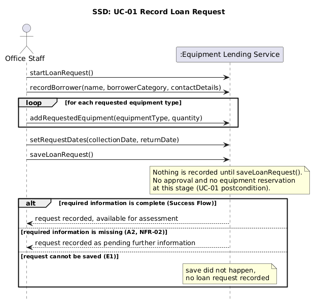
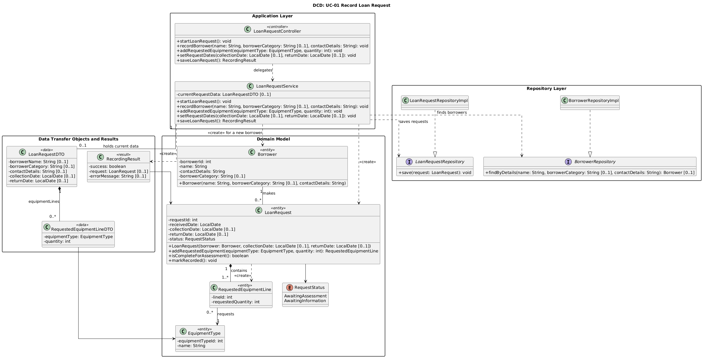
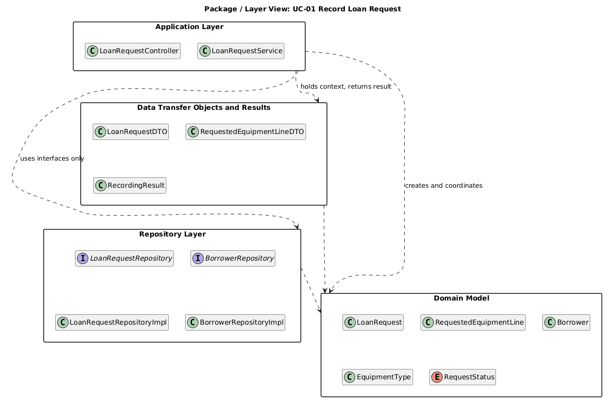

# CA2: Collaborative Object-Oriented Design
## Riverside Community Partnership Equipment Lending Service

## 1. Scenario Selection and Agreed Baseline
### 1.1 Scenario Comparison and Selection

| Project | Scope | Behavioural richness | OO potential | Sliceability | Testability | Comparability | Total score |
|---|---:|---:|---:|---:|---:|---:|---:|
| Community Equipment Loan Service | 4 | 5 | 5 | 4 | 4 | 5 | 4.5 |
| Farm Machinery Cooperative Service | 4 | 3 | 4 | 5 | 3 | 4 | 3.8 |
| Kerry Community Sports Facility Service | 3 | 5 | 5 | 4 | 4 | 5 | 4.3 |
| Harbour Equipment and Berth Service | 4 | 5 | 4 | 4 | 4 | 4 | 4.2 |

Each member presented the purpose, scope, actors, main use cases and domain concepts of their CA1 scenario. The group then scored each scenario from 1 to 5. The brief's four criteria were covered as follows: manageable scope (Scope), behavioural richness (Behavioural richness), object-oriented design potential (OO potential), and suitability for detailed use-case and interaction design (Sliceability, Testability and Comparability).

The Community Equipment Loan Service received the highest average score (4.5). Its lending process has a clear lifecycle, from recording a request through assessment, collection and return inspection, so a single use case can be designed in detail while still fitting into the larger process. Requests can contain several equipment types and quantities, information can be missing when a request arrives, and saving can fail. This gives meaningful alternative and failure behaviour for SSDs, operation contracts and sequence diagrams. The domain also contains several related concepts with clear responsibilities, such as Borrower, LoanRequest, RequestedEquipmentLine and EquipmentType, which gave good material for CRC cards and GRASP decisions.

The Kerry Community Sports Facility Service scored almost as high (4.3) and was equally strong in behavioural richness and OO potential, but its scope was scored lower (3), so it was judged harder to complete within the CA2 timeframe. The Harbour Equipment and Berth Service (4.2) was rich in behaviour, but it combined berth requests, provisional holds, equipment and vessel movements, which made a clean design slice harder to isolate. The Farm Machinery Cooperative Service (3.8) had a manageable scope and was easy to slice, but scored lower for behavioural richness and testability, so it offered fewer meaningful alternative paths to design.

The group therefore selected the Community Equipment Loan Service as the best balance of manageable scope and design potential.

### 1.2 Lecturer Approval and Expansion
The lecturer approved the Community Equipment Loan Service scenario
for CA2. No scenario-specific expansion was provided.

### 1.3 Reconciliation and Agreed Baseline Links
The following analysis artefacts form the agreed starting point
for the CA2 design:
The agreed analysis baseline is documented in the
[CA1 Analysis Dossier](https://github.com/KaterynaKon/Community-Equipment/blob/main/ca1-analysis/report/CA1-analysis.md ).
The multiplicity at the LoanRequest end of the StaffMember–LoanRequest
association was changed from 1..* to 0..*, allowing a staff member
to have no managed requests.

## 2. Product Goal, Backlog and Selected Design Scope

### 2.1 Product Goal

Make Riverside's equipment-lending service more reliable, consistent and
transparent, so that staff can make informed lending decisions and community
borrowers can plan their activities with clear confirmation of equipment,
collection arrangements and return dates.

### 2.2 Ordered Product Backlog

https://github.com/users/KaterynaKon/projects/2

### 2.3 Selected Use Case

#### Main User Story: US-01 Record Equipment Loan Request

| Field | Content |
|---|---|
| ID | US-01 |
| User story | As Office Staff, I want to record an equipment loan request with the borrower, the requested equipment and the dates, so that the request can be assessed without information being lost or missing. |
| Priority | Must |
| Links | FR-01; NFR-02; UC-01; SC-01; SC-02; SC-04; board item: GitHub Project CA2-Community-Equipment Design |
| Status | In progress |

**Acceptance criteria**
1. A request with borrower information, at least one equipment line, a collection date and a return date is recorded and available for assessment (SC-01).
2. A request can contain more than one equipment type, each with its own quantity.
3. A new borrower's information is recorded as part of the request (A1).
4. A request without a collection date or a return date is recorded as pending further information and cannot be assessed (SC-02, NFR-02).
5. A request cannot be saved until borrower information and at least one equipment line have been recorded.
6. If the service cannot save the request, no loan request is recorded and Office Staff are told, so they can follow the fallback procedure (SC-04).
7. Recording a request does not approve it or reserve any equipment.

#### Selected Use Cases

| Use Case | Value | Related Requirements / Rules | Dependencies | Selection Rationale |
|---|---|---|---|---|
| UC-01: Record Loan Request | Captures request information so staff can assess the borrowing request. | FR-01; NFR-02 | Staff have received a request by telephone or email and are authorised to record it. | Establishes the starting point of the lending process and supports multiple equipment lines and the alternative of missing required information. |

## 3. Behavioural Design

### 3.1 UC-01: Record Loan Request

#### Detailed Use Case

| Field | Content |
|---|---|
| Use Case ID | UC-01 |
| Name | Record Loan Request |
| Primary Actor | Office Staff |
| Goal | Record a new equipment loan request. |
| Trigger | Office Staff receives an equipment request from a borrower by telephone or email. |
| Preconditions | - Office Staff has received an equipment request from a borrower by telephone or email. - Office Staff is authorised to record a loan request. |
| Success Flow | 1. Office Staff starts recording a new loan request. 2. Office Staff records the borrower information. 3. Office Staff records the requested equipment, quantity, collection date and return date. 4. Office Staff saves the request. 5. The service records the request and makes it available for assessment. |
| Alternative Flows | A1. The borrower is new: Office Staff records the available borrower information as part of the request. A2. Required request information is missing: the request is recorded as pending further information and cannot be assessed until the missing information is recorded. |
| Exceptions | E1. The service cannot save the request, for example because internet access is unavailable. No loan request is recorded, and staff follow an agreed fallback procedure. |
| Minimal Guarantee | Whatever happens, no partial loan request, equipment line or new borrower is recorded, and no equipment is reserved. If the request cannot be saved, Office Staff are told that it was not saved. |
| Postconditions | - After successful recording, a complete request is available for assessment. - An incomplete request is recorded as pending further information and is not available for assessment. - No approval or equipment reservation is assumed at this stage. |
| Related Requirements / Rules | FR-01; NFR-02 |

#### Linked Gherkin Scenarios

ca1-analysis/features/equipment-lending.feature

- **SC-01:** Record a complete loan request.
- **SC-02:** Record a request with missing required information.
- **SC-04:** Loan request cannot be saved.

#### System Sequence Diagram

Source: `ca1-analysis/diagrams/ssd/ssd-uc01-record-loan-request.puml`

#### Operation Contracts

Cross references: US-01; UC-01; SC-01; SC-02; SC-04; SSD UC-01; FR-01; NFR-02

##### Shared Preconditions and Design Assumption

- Office Staff is authorised to record loan requests.
- Operations after `startLoanRequest()` require an active request-recording context.
- Following the SSD, supplied information is held temporarily until
  `saveLoanRequest()`. The group agreed to hold this information in a
  `LoanRequestDTO` owned by `LoanRequestService` (GRASP Decision 2).

##### OC-UC01-01: Start Loan Request

**Operation:** `startLoanRequest()`

**Postconditions:**
- A new request-recording context (LoanRequestDTO) was established.
- It is ready to receive borrower information, equipment lines and dates.
- No saved LoanRequest was created.

##### OC-UC01-02: Record Borrower Information

**Operation:** `recordBorrower(name, borrowerCategory, contactDetails)`

**Postconditions:**
- The supplied borrower information was retained in the active context.
- This operation does not yet create or update a saved Borrower record.

##### OC-UC01-03: Add Requested Equipment

**Operation:** `addRequestedEquipment(equipmentType, quantity)`

**Additional precondition:**
- `equipmentType` identifies an existing EquipmentType.

**Postconditions:**
- An equipment line containing the supplied type and quantity was added
  to the active context.
- Previously added equipment lines were retained.
- No physical EquipmentUnit was allocated or reserved.

##### OC-UC01-04: Set Request Dates

**Operation:** `setRequestDates(collectionDate, returnDate)`

**Postconditions:**
- The supplied collection and return dates were retained in the active context.
- An unknown date remains unset; it is not replaced with an invented date.

##### OC-UC01-05: Save Loan Request

**Operation:** `saveLoanRequest(): RecordingResult`

**Additional precondition:**
- The collected information meets the agreed minimum needed to save a request:
  borrower name and contact details, and at least one equipment line.
  This minimum is distinct from the information required for assessment
  (collection date and return date).
  Group design assumption: these minimum-information rules are not explicitly specified in the scenario and require stakeholder confirmation.

**Postconditions — successful recording:**
- A LoanRequest was created.
- Its supplied collectionDate and returnDate were set.
- A RequestedEquipmentLine was created for each collected equipment line.
- Each line's requestedQuantity was set.
- Each line was associated with the LoanRequest and its EquipmentType.
- The LoanRequest was associated with the identified Borrower.
- For a new borrower, a Borrower was created from the supplied
  information and saved together with the LoanRequest.
- The returned RecordingResult reports success.

**Complete information — SC-01:**
- The request's status was set to AwaitingAssessment (available for assessment).
- No approval decision was recorded.

**Missing required assessment information — SC-02:**
- The request's status was set to AwaitingInformation (pending further information).
- The request is not available for assessment.

**Controlled failure — E1 / SC-04:**
- No LoanRequest, RequestedEquipmentLine or new Borrower is recorded.
- The returned RecordingResult reports failure with an error message;
  successful recording is not reported.
- Staff follow the agreed fallback procedure.

**Reservation:**
- Saving the request does not imply approval or equipment reservation.

## 4. Responsibilities and GRASP
The **Class-Responsibility-Collaborator (CRC)** model identifies the responsibilities assigned to each class used by UC-01 in the Equipment Lending Service. It describes what information each class knows, what actions it performs, which other classes it collaborates with and why the responsibility was placed there.

Responsibilities are divided into:
- **Knowing responsibilities:** Information that a class maintains or needs to know to perform its work.
- **Doing responsibilities:** Actions or operations that a class performs.
- **Collaborators**: Other classes that help it fulfil its responsibilities.

The **GRASP (General Responsibility Assignment Software Patterns)** principles are used to justify how responsibilities are distributed throughout the system.
The main principles considered in this design are:
- **Controller:** Assigns responsibility for handling system events to an appropriate controller.
- **Information Expert:** Assigns a responsibility to the class that has the information needed to fulfil it.
- **Creator:** Assigns responsibility for creating an object to a class that contains, aggregates, records or closely uses it.
- **High Cohesion:** Keeps responsibilities within a class focused and related.
- **Low Coupling:** Minimises unnecessary dependencies between classes.
- **Indirection:** Introduces an intermediate class to reduce direct dependencies.
- **Pure Fabrication:** Introduces a class for a technical responsibility that does not naturally belong to a domain entity.

### 4.1 CRC Cards
| Class | Knowing responsibilities | Doing responsibilities | Collaborators | Rationale |
|---|---|---|---|---|
| LoanRequestController | The system operations available to Office Staff for UC-01. | Receives each SSD system event and delegates it to LoanRequestService. Returns the RecordingResult of saveLoanRequest(). | LoanRequestService, RecordingResult | Controller (Decision 1): keeps user-interface events separate from the workflow. |
| LoanRequestService | The current request-recording context (LoanRequestDTO) until saveLoanRequest(). | Stores supplied information in the DTO. On saving, finds or creates the Borrower, creates the LoanRequest, asks it to add its lines and set its status, saves it and builds the RecordingResult. | LoanRequestDTO, Borrower, LoanRequest, BorrowerRepository, LoanRequestRepository, RecordingResult | Pure Fabrication that coordinates the use-case workflow (Decisions 1, 2 and 5). |
| LoanRequestDTO | Borrower details, dates and equipment lines supplied before saving. | Holds data only. | LoanRequestService, RequestedEquipmentLineDTO | Pure Fabrication (Decision 2): no LoanRequest exists before saving. |
| RequestedEquipmentLineDTO | Equipment type and quantity supplied before saving. | Holds data only. | LoanRequestDTO, EquipmentType | Part of the temporary context (Decision 2). |
| Borrower | Name, contact details and borrower category. | Represents the person or group making the request. | LoanRequest | Created by LoanRequestService for a new borrower (Decision 5). |
| LoanRequest | Received date, collection and return dates, status, borrower and equipment lines. | Creates and maintains its RequestedEquipmentLines. Checks whether its information is complete for assessment. Sets its own status when recorded. | Borrower, RequestedEquipmentLine, RequestStatus | Creator (Decision 2) and Information Expert (Decision 4). |
| RequestedEquipmentLine | Requested equipment type and quantity. | Represents one requested equipment type within a request. | LoanRequest, EquipmentType | Part of the LoanRequest; no availability responsibility in UC-01. |
| EquipmentType | Equipment type name. | Identifies the kind of equipment requested. | RequestedEquipmentLine | Existing catalogue entry (OC-UC01-03 precondition). |
| RecordingResult | Whether saving succeeded, the saved request and any error message. | Carries the outcome of saveLoanRequest() back to Office Staff. | LoanRequestService, LoanRequestController, LoanRequest | Shared result convention (6.3). |
| LoanRequestRepository | The operation for saving a new loan request. | Defines save(request). | LoanRequestService, LoanRequest | Indirection and Low Coupling (Decision 3). |
| LoanRequestRepositoryImpl | How request data is stored. | Saves the request, its lines and a new borrower as one unit. | LoanRequestRepository, LoanRequest | Hides the storage technology (Decision 3). |
| BorrowerRepository | The operation for finding an existing borrower. | Defines findByDetails(). | LoanRequestService, Borrower | Indirection (Decision 5). |
| BorrowerRepositoryImpl | How borrower data is stored. | Finds borrowers in storage. | BorrowerRepository, Borrower | Hides the storage technology. |

### 4.2 GRASP Decision Records

#### Decision 1: Receiving and coordinating loan requests

**Selected classes:** LoanRequestController, LoanRequestService

| Field | Content |
|---|---|
| Problem | A class must receive the UC-01 system events from Office Staff and coordinate the process of recording the request, including handling incomplete information. |
| Candidate assignments | LoanRequestController, LoanRequestService, LoanRequest |
| Selected assignment | **LoanRequestController** receives each system event from the user interface (startLoanRequest, recordBorrower, addRequestedEquipment, setRequestDates, saveLoanRequest) and delegates it to **LoanRequestService**. **LoanRequestService** coordinates the request-recording workflow, including identifying or creating the Borrower, creating the LoanRequest and saving it. |
| GRASP principle | **Controller:** LoanRequestController handles the system events shown in the SSD and delegates the work to the service. **High Cohesion:** The controller focuses on handling system events, while the service coordinates the business workflow. |
| Rejected alternative | Assigning the entire request-recording process to LoanRequestController was rejected because it would combine interface handling, borrower identification, validation and request-management logic in one class. Making LoanRequest receive the system events was rejected because it is a domain object, not a receiver for external events. |
| Consequences | Separates interface communication from business logic, making the request-recording process easier to test and maintain. However, it introduces an additional service class, and the controller repeats the five service operations. |

#### Decision 2: Holding request information and creating the loan request

**Selected classes:** LoanRequestService, LoanRequestDTO, LoanRequest, RequestedEquipmentLine

| Field | Content |
|---|---|
| Problem | Request information arrives in several steps, but nothing may be recorded until saveLoanRequest() (OC-UC01-01 to 04). When saving, the system must create a LoanRequest with one or more RequestedEquipmentLines, each with an equipment type and quantity. |
| Candidate assignments | LoanRequestController, LoanRequestService, LoanRequestDTO, LoanRequest |
| Selected assignment | Until saving, **LoanRequestService** keeps the supplied information in a **LoanRequestDTO** with **RequestedEquipmentLineDTO** items. On saveLoanRequest(), the service creates the **LoanRequest** from the DTO data, and the LoanRequest creates one **RequestedEquipmentLine** for each collected line through `addRequestedEquipment(equipmentType, quantity)`. |
| GRASP principle | **Pure Fabrication:** LoanRequestDTO is a technical class that holds unsaved information, which does not belong to any domain object. **Creator:** LoanRequestService creates the LoanRequest because it holds the initialising data; LoanRequest creates its RequestedEquipmentLines because it contains them. **High Cohesion:** the service coordinates, while LoanRequest manages its own lines. |
| Rejected alternative | Creating a LoanRequest at startLoanRequest() and filling it step by step was rejected in favour of a LoanRequestDTO to separate incomplete data capture from domain-object creation. Letting the controller or service create RequestedEquipmentLines directly was rejected because LoanRequest contains and maintains them. |
| Consequences | Captured information is held in the DTO until saving, and equipment lines are maintained by LoanRequest. Atomic saving (Decision 3) ensures that no partially saved data remains if saving fails. However, LoanRequestDTO repeats some fields of LoanRequest,and both must be kept consistent. |

#### Decision 3: Saving a new loan request

**Selected classes:** LoanRequestRepository, LoanRequestRepositoryImpl, LoanRequestService

| Field | Content |
|---|---|
| Problem | The system must save a new loan request with its equipment lines and, for a new borrower, the new Borrower. If saving fails, nothing may be recorded (E1). |
| Candidate assignments | LoanRequest, LoanRequestService, LoanRequestRepository, LoanRequestRepositoryImpl |
| Selected assignment | **LoanRequestRepository** defines `save(request)`. **LoanRequestRepositoryImpl** implements it and stores the request, its lines and a new borrower as one unit. **LoanRequestService** depends only on the LoanRequestRepository interface. |
| GRASP principle | **Indirection:** LoanRequestRepository provides an intermediate layer between LoanRequestService and the storage implementation. **Low Coupling:** LoanRequestService depends on the repository interface rather than on LoanRequestRepositoryImpl or database-specific operations. |
| Rejected alternative | Allowing LoanRequestService to execute database queries directly was rejected because it would tightly couple business logic to database operations. Saving a new Borrower through a separate call before saving the request was rejected because a failure between the two saves would leave a Borrower without a request, breaking the E1 guarantee. |
| Consequences | Storage is separated from business logic, making the system easier to test and maintain, and E1 is guaranteed by saving everything as one unit. However, the repository implementation must handle the new borrower together with the request. |

#### Decision 4: Checking request completeness and setting the status

**Selected classes:** LoanRequest, LoanRequestService

| Field | Content |
|---|---|
| Problem | A recorded request must be available for assessment only when it contains the information required for assessment. Otherwise, it must be recorded as pending further information (NFR-02, SC-02). |
| Candidate assignments | LoanRequest, LoanRequestService, LoanRequestController |
| Selected assignment | **LoanRequestService** calls `markRecorded()` on the new **LoanRequest** before saving it. **LoanRequest** uses `isCompleteForAssessment()` to check its collection and return dates and sets its own status to `AwaitingAssessment` or `AwaitingInformation`. |
| GRASP principle | **Information Expert:** LoanRequest holds the information needed for the check. **High Cohesion:** LoanRequest protects its own status, while LoanRequestService only coordinates the workflow. |
| Rejected alternative | Placing the check in LoanRequestController was rejected because it would put business rules in the controller. A public `changeStatus(status)` operation used by the service was rejected because it would allow any status to be set, including invalid transitions. |
| Consequences | The completeness rule and status change are kept with the information they depend on, which supports NFR-02. However, the required-information rule (collection and return dates) is a group assumption and must be updated if the request policy changes. |

#### Decision 5: Identifying or creating the borrower

**Selected classes:** LoanRequestService, BorrowerRepository, Borrower

| Field | Content |
|---|---|
| Problem | Every LoanRequest must be associated with a Borrower. For a new borrower (A1), a Borrower must be created from the supplied information. |
| Candidate assignments | LoanRequestController, LoanRequestService, LoanRequest, BorrowerRepository |
| Selected assignment | **LoanRequestService** calls `BorrowerRepository.findByDetails(...)`. If no borrower is found, the service creates a new **Borrower** from the LoanRequestDTO data. The new Borrower is saved together with the request (Decision 3). |
| GRASP principle | **Creator:** LoanRequestService holds the initialising data for the Borrower. **Indirection:** BorrowerRepository hides how borrowers are found. |
| Rejected alternative | Letting LoanRequest create the Borrower was rejected because a Borrower exists independently of any single request and can make many requests (1 to 0..*). Letting the controller search for borrowers was rejected because it would place workflow logic in the controller. |
| Consequences | Existing borrowers are reused, and new borrowers are created only when needed. However, if borrower details are entered differently, a duplicate Borrower may be created. |

## 5. Object-Interaction Design
### 5.1 UC-01: Record Loan Request

One design sequence diagram was produced for each system operation in the
SSD. Every message corresponds to an operation in the design class
diagram, and every diagram realises the postconditions of its
operation contract.

#### SD-UC01-01: startLoanRequest()

startLoanRequest(). Office Staff start a new request. The controller passes the call to the service, which creates an empty LoanRequestDTO to hold the data temporarily. No real LoanRequest is created yet.

#### SD-UC01-02: recordBorrower()

recordBorrower(). Office Staff enter the borrower's details. The service stores them in the DTO with setBorrower(). No Borrower object is created; the data is only held.
OC-UC01-02 · Decisions 1, 2

#### SD-UC01-03: addRequestedEquipment()

addRequestedEquipment(). Office Staff add one equipment item, e.g. "chairs × 10". The service creates a RequestedEquipmentLineDTO and adds it to the DTO with addLine(line). This is repeated for each item. No equipment is reserved.

#### SD-UC01-04: setRequestDates()

setRequestDates(...). Office Staff enter the collection and return dates. The service stores them in the DTO with setDates(...). An unknown date stays empty; it is never invented.

#### SD-UC01-05: saveLoanRequest(): RecordingResult

saveLoanRequest(). Office Staff save the request, and the real objects are created from the DTO:

The service looks for the borrower (findByDetails). If none is found, it creates a new Borrower.
The service creates the LoanRequest (Decision 2).
In a loop, the LoanRequest creates its own RequestedEquipmentLines.
markRecorded(): the request checks itself (isCompleteForAssessment()) and sets its status to AwaitingAssessment (SC-01), or to AwaitingInformation if a date is missing.
save(request) stores everything as one unit. If storage fails, the repository throws an exception and nothing is saved.
The service creates a RecordingResult (success or failure) and returns it to Office Staff.

#### Consistency check: sequence messages, DCD operations and contracts

Every message in SD01 to SD05 was checked against an operation on the receiving class in the DCD (6.1) and against the operation contract it realises.

| Diagram | Sequence message | Receiving class | DCD operation | Realises |
|---|---|---|---|---|
| SD01 | startLoanRequest() | LoanRequestController, LoanRequestService | startLoanRequest(): void | SSD event; OC-UC01-01 |
| SD01 | `<<create>>` | LoanRequestDTO | LoanRequestDTO() | OC-UC01-01: request-recording context established, no LoanRequest created |
| SD02 | recordBorrower(name, borrowerCategory, contactDetails) | LoanRequestController, LoanRequestService | recordBorrower(...): void | SSD event; OC-UC01-02 |
| SD02 | setBorrower(name, borrowerCategory, contactDetails) | LoanRequestDTO | setBorrower(...): void | OC-UC01-02: borrower information retained, no Borrower created |
| SD03 | addRequestedEquipment(equipmentType, quantity) | LoanRequestController, LoanRequestService | addRequestedEquipment(...): void | SSD event; OC-UC01-03 |
| SD03 | `<<create>>`(equipmentType, quantity) | RequestedEquipmentLineDTO | RequestedEquipmentLineDTO(...) | OC-UC01-03: equipment line added to the context |
| SD03 | addLine(line) | LoanRequestDTO | addLine(line): void | OC-UC01-03: previous lines retained, nothing reserved |
| SD04 | setRequestDates(collectionDate, returnDate) | LoanRequestController, LoanRequestService | setRequestDates(...): void | SSD event; OC-UC01-04 |
| SD04 | setDates(collectionDate, returnDate) | LoanRequestDTO | setDates(...): void | OC-UC01-04: unknown date stays unset |
| SD05 | saveLoanRequest() | LoanRequestController, LoanRequestService | saveLoanRequest(): RecordingResult | SSD event; OC-UC01-05 |
| SD05 | findByDetails(name, borrowerCategory, contactDetails) | BorrowerRepository | findByDetails(...): Borrower [0..1] | Decision 5; A1 |
| SD05 | `<<create>>`(name, borrowerCategory, contactDetails) | Borrower | Borrower(...) | OC-UC01-05: new Borrower created for a new borrower |
| SD05 | `<<create>>`(borrower, collectionDate, returnDate) | LoanRequest | LoanRequest(...) | OC-UC01-05: LoanRequest created and associated with Borrower |
| SD05 | addRequestedEquipment(equipmentType, quantity) | LoanRequest | addRequestedEquipment(...): RequestedEquipmentLine | Decision 2 (Creator); OC-UC01-05: one line per collected line |
| SD05 | `<<create>>`(equipmentType, quantity) | RequestedEquipmentLine | RequestedEquipmentLine(...) | OC-UC01-05: quantity set, line associated with EquipmentType |
| SD05 | markRecorded() | LoanRequest | markRecorded(): void | Decision 4; SC-01 / SC-02 status |
| SD05 | isCompleteForAssessment() | LoanRequest | isCompleteForAssessment(): boolean | Decision 4 (Information Expert); NFR-02 |
| SD05 | save(request) | LoanRequestRepository | save(request): void | Decision 3; OC-UC01-05 saved as one unit |
| SD05 | `<<create>>`(success, request, errorMessage) | RecordingResult | RecordingResult(...) | 6.3 result convention; SC-01, SC-02, SC-04 |

Result of the check:
- Every message maps to an operation on the receiving class in the DCD; no DCD operation used by UC-01 is missing.
- Every DCD operation in the Application, DTO, Domain and Repository packages is used by at least one sequence diagram.
- The failure path in SD05 (storage failure during save) returns RecordingResult with success = false and keeps nothing, which matches the E1 no-change guarantee in OC-UC01-05.
- Status values are shown as notes rather than messages, because they are internal assignments inside markRecorded(), not separate operations.

## 6. Integrated Design Model and Structure
### 6.1 Design Class Diagram

Source: `ca1-analysis/diagrams/class-diagrams/classDiagrams.puml`

The design class diagram contains only the classes, operations and relationships used by UC-01. Classes for assessment, collection, return inspection and damage belong to later use cases and are not part of this design.

### 6.2 Package / Layer View

Source: `ca1-analysis/diagrams/package-view/package-layer-view.puml`

The UC-01 design is organised into four packages that use the same names as the design class diagram (6.1).

| Package | Classes | Responsibility |
|---|---|---|
| Application Layer | LoanRequestController, LoanRequestService | Receives the SSD system events and coordinates the recording workflow. |
| Data Transfer Objects and Results | LoanRequestDTO, RequestedEquipmentLineDTO, RecordingResult | Holds supplied information until saveLoanRequest() and returns the outcome to Office Staff. |
| Domain Model | LoanRequest, RequestedEquipmentLine, Borrower, EquipmentType, RequestStatus | Holds request information and request rules, such as isCompleteForAssessment(). |
| Repository Layer | LoanRequestRepository, BorrowerRepository and their implementations | Saves loan requests and finds borrowers. |

Dependency rules:
- Dependencies point in one direction: Application Layer → DTO, Domain Model and repository interfaces; Repository Layer → Domain Model.
- The Domain Model depends on no other package, so request rules do not depend on storage or the user interface.
- LoanRequestService depends only on the repository interfaces, not on the Impl classes (Decision 3).
- The user interface is not modelled; LoanRequestController is the entry point for the system events shown in the SSD.
- Data Transfer Objects and Results depends on Domain Model because RequestedEquipmentLineDTO references EquipmentType and RecordingResult references LoanRequest.

### 6.3 Interfaces, Result Types and Error Conventions

#### Interfaces used by UC-01

| Interface / class | Operation | Used by | Purpose |
|---|---|---|---|
| LoanRequestController | startLoanRequest(), recordBorrower(...), addRequestedEquipment(...), setRequestDates(...), saveLoanRequest(): RecordingResult | Office Staff (through the user interface) | System operations from the SSD; one operation per system event. |
| BorrowerRepository | findByDetails(name, borrowerCategory, contactDetails): Borrower [0..1] | LoanRequestService | Identifies an existing borrower; no result means a new borrower (A1). |
| LoanRequestRepository | save(request: LoanRequest): void | LoanRequestService | Saves the new LoanRequest with its RequestedEquipmentLines and any new Borrower as one unit. |

#### Result type: RecordingResult

startLoanRequest(), recordBorrower(), addRequestedEquipment() and setRequestDates() return nothing because they only update the temporary LoanRequestDTO. saveLoanRequest() returns a RecordingResult (success, request [0..1], errorMessage [0..1]).

| Outcome | success | request | Request status | errorMessage | SSD message | Gherkin |
|---|---|---|---|---|---|---|
| Complete request saved | true | saved LoanRequest | AwaitingAssessment | empty | request recorded, available for assessment | SC-01 |
| Incomplete request saved (A2) | true | saved LoanRequest | AwaitingInformation | empty | request recorded as pending further information | SC-02 |
| Save failed (E1) | false | empty | none | reason for failure | request not saved, no loan request recorded | SC-04 |

#### Error conventions

1. Missing assessment information is not an error. The request is saved with AwaitingInformation status and success = true (A2, NFR-02).
2. The repository signals a storage failure by throwing an exception. LoanRequestService catches it and returns RecordingResult with success = false, no saved request and an error message.
3. The repository implementation must save the LoanRequest, its lines and any new Borrower atomically: either all are saved or none are saved. If any part fails, all storage changes from this save operation must be rolled back (OC-UC01-05, E1).
4. The minimum for saving (borrower name and contact details, and at least one equipment line) is a precondition of saveLoanRequest(). The user interface does not offer saving until this minimum has been recorded.
5. "Available for assessment" in the use case and Gherkin corresponds to the AwaitingAssessment status; "pending further information" corresponds to AwaitingInformation.

## 7. Traceability Matrix

Board items are shown in brackets.

| Requirement | User Story | Use Case | Gherkin | SSD operation (#5) | Operation Contract (#6) | CRC / GRASP (#7) | DCD element | Interaction 5.1 (#9) |
|---|---|---|---|---|---|---|---|---|
| FR-01 | US-01 | UC-01 | SC-01 | startLoanRequest() | OC-UC01-01 | LoanRequestController, LoanRequestService, LoanRequestDTO; Decisions 1, 2 | LoanRequestController.startLoanRequest(), LoanRequestService.startLoanRequest(), LoanRequestDTO | SD01 |
| FR-01 | US-01 | UC-01 (A1) | SC-01 | recordBorrower() | OC-UC01-02 | LoanRequestController, LoanRequestService, LoanRequestDTO; Decisions 1, 2 | recordBorrower(), LoanRequestDTO | SD02 |
| FR-01 | US-01 | UC-01 | SC-01 | addRequestedEquipment() | OC-UC01-03 | LoanRequestService, RequestedEquipmentLineDTO; Decision 2 | addRequestedEquipment(), RequestedEquipmentLineDTO | SD03 |
| FR-01 | US-01 | UC-01 | SC-01 | setRequestDates() | OC-UC01-04 | LoanRequestController, LoanRequestService, LoanRequestDTO; Decisions 1, 2 | setRequestDates(), LoanRequestDTO | SD04 |
| FR-01 | US-01 | UC-01 (A1) | SC-01 | saveLoanRequest() | OC-UC01-05 | LoanRequestService, Borrower, LoanRequest, RequestedEquipmentLine, repositories; Decisions 2, 3, 5 | saveLoanRequest(): RecordingResult, BorrowerRepository.findByDetails(), Borrower(...), LoanRequest(...), LoanRequest.addRequestedEquipment(), LoanRequestRepository.save() | SD05 |
| FR-01, NFR-02 | US-01 | UC-01 (A2) | SC-02 | saveLoanRequest() | OC-UC01-05 | LoanRequest; Decision 4 | LoanRequest.markRecorded(), LoanRequest.isCompleteForAssessment(), RequestStatus | SD05 |
| FR-01 | US-01 | UC-01 (E1) | SC-04 | saveLoanRequest() | OC-UC01-05 | LoanRequestRepository, RecordingResult; Decision 3 | LoanRequestRepository.save(), RecordingResult (success = false) | SD05 |

## 8. Design Evaluation
### 8.1 Cohesion, Coupling, Controllers and Object Validity

**Controller.** LoanRequestController receives the five SSD system events and delegates them to LoanRequestService, so no business rule is placed in the controller (Decision 1). The weakness of this choice is that the controller repeats the service operations one to one and adds little behaviour of its own. We accepted this because it keeps the entry point for the user interface separate from the workflow, and the service can be tested without the interface. A single use-case controller, as in the Session 14 example, would remove the duplication but would mix event handling with coordination.

**Cohesion.** Responsibilities are kept close to the information they use. LoanRequest creates its own RequestedEquipmentLines (Creator) and decides whether it is complete and which status it receives (Information Expert, Decision 4). Replacing the public changeStatus() with markRecorded() means the status cannot be set to an invalid value from outside. LoanRequestService has lower cohesion than the domain classes because it coordinates several steps of saveLoanRequest(): finding the borrower, creating the request, setting the status, saving and building the result. This is acceptable for a service that coordinates one use case, but it would need to be split if more use cases were added to the same class.

**Coupling.** Dependencies point in one direction (6.2). The Domain Model depends on no other package, and LoanRequestService depends only on the repository interfaces, not on their implementations (Indirection, Decision 3). This means storage can change without changing the service. The DTO package depends on the Domain Model because RequestedEquipmentLineDTO refers to EquipmentType and RecordingResult refers to LoanRequest. This coupling is small and was accepted to avoid copying equipment-type data.

**Object validity.** Before saving, information is held only in LoanRequestDTO, so no partially filled LoanRequest can exist (Decision 2). A LoanRequest is created only on saveLoanRequest(), always with a Borrower and at least one RequestedEquipmentLine, which matches the multiplicities in the DCD (1 and 1..*). A request without dates is still a valid object, but it receives the AwaitingInformation status and cannot be assessed (NFR-02). Saving is atomic, so after a failure (E1) no LoanRequest, line or new Borrower remains.

### 8.2 Assumptions, Risks, Rejected Alternatives and Limitations

**Assumptions**
- The minimum for saving is borrower name and contact details and at least one equipment line; the information required for assessment is the collection date and the return date. The scenario does not define these rules, so they need stakeholder confirmation.
- The user interface does not allow saving until the minimum has been recorded, so this is treated as a precondition rather than a refusal outcome.
- An existing borrower can be identified by name, category and contact details.

**Risks**
- LoanRequestService holds one current request (currentRequestData). If two staff members record requests at the same time through one service instance, their data could mix. A real implementation would need one context per staff session.
- If borrower details are typed differently, findByDetails() may not find an existing borrower and a duplicate Borrower may be created (Decision 5).
- LoanRequestDTO repeats fields of LoanRequest. If one changes and the other does not, data may be lost when saving.
- Atomic saving depends on the repository implementation supporting rollback.

**Rejected alternatives**
- Creating a LoanRequest at startLoanRequest() and filling it step by step (Decision 2): rejected because a failed or abandoned recording would leave a partial request.
- A public changeStatus(status) operation (Decision 4): rejected because it would allow any status, including invalid transitions.
- Saving a new Borrower separately before the request (Decision 3): rejected because a failure between the two saves would leave a Borrower without a request.
- Letting LoanRequest create the Borrower (Decision 5): rejected because a Borrower exists independently and can make many requests.

**Limitations**
- Only UC-01 was designed in detail. Assessment, collection and return are outside this design, so the status model contains only AwaitingAssessment and AwaitingInformation.
- The design does not check equipment availability or quantity limits; these belong to assessment.
- The user interface and the storage technology are not modelled.
- The design is not implemented, so the conventions in 6.3 have not been tested.

## 9. Collaboration, Review and AI Disclosure

### 9.1 Iteration Goals and Definition of Done

**Iteration goal:** Complete and review the UC-01 design, from the use
case and contracts to class responsibilities, object interactions
and the design class diagram.

**Definition of Done:** Work is complete when:

- Editable files are committed to the repository, and diagrams can
  be opened and read clearly.
- Terminology, operation names and traceability links are consistent.
- Each member's work is reviewed by at least one other team member.
  Review comments are either addressed or recorded as open issues.
- Repository evidence, board status and relevant AI-use records
  are updated.

### 9.2 Peer Review and Final Retrospective

**Peer review:** Team members reviewed one another's work as the
UC-01 design developed. The shared repository and board supported
collaboration and tracking of design tasks.

**Final retrospective:**

- **Keep:** Sharing tasks and reviewing each other's work helped
  the team develop the design collaboratively.
- **Problem:** Diagrams created separately needed additional work
  to keep operation names and responsibilities consistent.
- **Improve:** Agree shared operation names before creating diagrams
  and review related artefacts together.
  
### 9.3 Individual Contribution Evidence

| Issue | Task | Member(s) |
|---|---|---|
| #1 | Document scenario comparison and selection | All team members |
| #2 | Reconciliation and expansion record | Kateryna Konieva |
| #3 | Revised analysis baseline | Kateryna Konieva |
| #4 | Prioritised implementation catalogue | Arsen Ibrahimov|
| #5 | System sequence diagrams | Anastasiia Tkachenko|
| #6 | Operation contracts | Kateryna Konieva|
| #7 | CRC/responsibility model | Sofiia Fedchuk |
| #8 | Design class diagram | Sofiia Fedchuk |
| #9 | Object-interaction sequence diagrams | Arsen Ibrahimov |
| #17 | Traceability matrix | Anastasiia Tkachenko |
| #19 | Package/layer view for UC-01 (6.2) | Anastasiia Tkachenko |
| #20 | Interfaces, result types and error conventions for UC-01 (6.3) | Anastasiia Tkachenko |
| #22 | Design evaluation | Anastasiia Tkachenko |
### 9.4 Group and Individual AI Declarations

### 9.4 Group and Individual AI Declarations

#### Group AI declaration

| Field | Content |
|---|---|
| AI tools used | Claude, ChatGPT|
| Affected artefacts | DCD consistency check, sequence diagram drafts, wording of section 8 |
| How AI output was checked | Every suggestion was compared with the use case, contracts (3.1), GRASP decisions and the DCD before it was accepted. Changes went through a pull request and peer review |
| Significant accepted AI-supported changes | Adding setBorrower(), addLine(), setDates() and constructors to the DCD |
| Interaction logs | [GROUP: links to each member's AI log, e.g. docs/ai-logs/ai-log-arsen.md] |

#### Individual AI declarations

##### Katerina

[YOU: 4–6 sentences in your own words, answering:
1. Which AI tool(s) did you use?
2. What did you use it for? (e.g. understanding how to build design sequence diagrams from contracts, finding inconsistencies between the diagrams and the DCD, git help, English wording)
3. One concrete example where you checked an AI suggestion and changed or rejected it, and why.
4. How did you check the output? (contracts in 3.1, Decisions in 4.2, DCD, rendering in PlantUML)
5. Confirm that you can explain your diagrams and made the final decisions.]

Log: [link to docs/ai-logs/ai-log-arsen.md]

##### Sofiia

[YOU: 4–6 sentences in your own words, answering:
1. Which AI tool(s) did you use?
2. What did you use it for? (e.g. understanding how to build design sequence diagrams from contracts, finding inconsistencies between the diagrams and the DCD, git help, English wording)
3. One concrete example where you checked an AI suggestion and changed or rejected it, and why.
4. How did you check the output? (contracts in 3.1, Decisions in 4.2, DCD, rendering in PlantUML)
5. Confirm that you can explain your diagrams and made the final decisions.]

##### Anastasiia

[YOU: 4–6 sentences in your own words, answering:
1. Which AI tool(s) did you use?
2. What did you use it for? (e.g. understanding how to build design sequence diagrams from contracts, finding inconsistencies between the diagrams and the DCD, git help, English wording)
3. One concrete example where you checked an AI suggestion and changed or rejected it, and why.
4. How did you check the output? (contracts in 3.1, Decisions in 4.2, DCD, rendering in PlantUML)
5. Confirm that you can explain your diagrams and made the final decisions.]

##### Arsen Ibrahimov

[YOU: 4–6 sentences in your own words, answering:
1. Which AI tool(s) did you use?
2. What did you use it for? (e.g. understanding how to build design sequence diagrams from contracts, finding inconsistencies between the diagrams and the DCD, git help, English wording)
3. One concrete example where you checked an AI suggestion and changed or rejected it, and why.
4. How did you check the output? (contracts in 3.1, Decisions in 4.2, DCD, rendering in PlantUML)
5. Confirm that you can explain your diagrams and made the final decisions.]

### 9.5 Evidence Links and Final Submission Tag
- [Group repository](https://github.com/KaterynaKon/Community-Equipment )
- [Project board](https://github.com/users/KaterynaKon/projects/2 )
- [Commit history](https://github.com/KaterynaKon/Community-Equipment/commits/main/ )
- **Final submission tag:** Pending.

## References
1. CA1 Scenario 01: Community Equipment Loan Service — Riverside Community Partnership. Module-provided scenario.
2. CA2: Collaborative Object-Oriented Design. Assignment brief.
